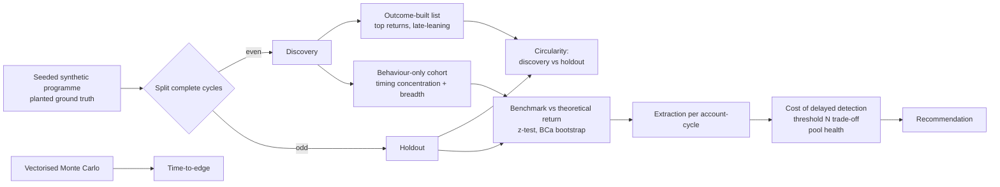

# Incentive exploitation: cohort validation and cost of delayed detection

**Outcome:** a costed decision on when to detect and act on accounts that time their activity to a predictable reward schedule, using a cohort definition that can be validated without circularity.

All data in this repository is synthetic, generated with a fixed seed. No figure here describes a real programme.

## Problem

A marketplace runs a recurring cashback pool. Every qualifying spend earns a base cashback and adds to a shared pool, which pays out pro rata to the spend of the step in which it pays. The chance of paying out rises predictably as the cycle runs, so concentrating spend late in the cycle earns more than spreading it evenly.

The business needs three answers: which accounts are doing this, how much they actually extract, and how long it can afford to wait before acting. The trap is validating the effect against a list of accounts that were selected *because* they did well: that list will always look profitable.

## Approach



1. **Circularity demonstration.** A "flagged list" built partly from outcomes (late-leaning accounts in the top 5% of discovery returns) is measured on the cycles that built it and on holdout.
2. **Behaviour-only cohort.** Late-entry share tested with a one-sided exact binomial test against the share of *time* the programme spends late in its cycle (a label-free baseline), Benjamini-Hochberg at 1% FDR, plus exposure breadth (late entries in at least 3 cycles). Outcomes are never used, which a test enforces.
3. **Benchmark.** Observed cohort return against the theoretical return for evenly spread spend, computed from the programme trajectory alone. z-test on a pooled standard error with accounts as the unit; BCa bootstrap intervals.
4. **Time-to-edge.** A vectorised Monte Carlo of the planted strategy: cycles until the cumulative return clears +1/+2/+3% at 50/70/90% confidence, with a sustained-crossing check.
5. **Cost to the business.** Extraction per account per cycle on holdout; loss accrued before detection as a function of N; the detection threshold N that minimises expected cost; pool share taken vs funded; regular accounts' return with and without exploiters.

The narrative and charts are in [`analyses/incentive-exploitation/incentive_exploitation.ipynb`](analyses/incentive-exploitation/incentive_exploitation.ipynb); the tested logic is in `src/fraud_analytics/`.

## Results (synthetic data, seed 7, 95% intervals)

Theoretical return for evenly spread spend: **0.880**. One year, 84 complete cycles, 613k entries.

**Circularity.** The outcome-built list (111 accounts, 21% planted exploiters) earns 1.201 (1.182 - 1.226) on the cycles that selected it and 0.926 (0.902 - 0.955) on holdout. Most of its apparent premium came from the selection. The behaviour-only cohort holds its level: 0.990 on discovery, 0.983 on holdout.

**Behaviour-only cohort.** 71 of 3,768 assessed accounts flagged (69 exploiting, 2 heavy legitimate). Precision 0.97 (0.90 - 0.99); recall over all 120 planted 0.57 (0.49 - 0.66).

| Cohort | Accounts | Observed return | z vs theoretical |
|---|---|---|---|
| Behaviour-only, holdout | 71 | 0.983 (0.940 - 1.013) | 5.2 |
| Unknown to the list, holdout | 54 | 0.981 (0.930 - 1.020) | 4.4 |
| Planted exploiting (truth) | 120 | 1.019 (1.000 - 1.038) | 14.4 |
| Planted heavy legitimate (truth) | 200 | 0.887 (0.883 - 0.892) | 3.3 |
| Planted regular (truth) | 3,674 | 0.879 (0.877 - 0.881) | -0.4 |

**Time-to-edge** (planted strategy, long-run return 1.070 vs 0.882 for evenly spread spend):

| Confidence | +1% | +2% | +3% |
|---|---|---|---|
| 50% | 6 cycles | 6 | 7 |
| 70% | 31 | 53 | 90 |
| 90% | 206 | 295 | 457 |

A coin-flip chance of being ahead comes within a handful of cycles, but a reliable edge takes hundreds. 83% of paths stay above +1% for every cycle after the 90% point.

**Cost.** Extraction is 2.74 (2.20 - 3.35) credits per exploiting account per cycle, or 195 (156 - 238) per cycle for the cohort and 16,343 (13,100 - 20,004) over the year.

**Pool health.** The programme seeds the pool every cycle, so every group gets back more than it contributes; the gap between groups is the finding.

| Group | Contributed / account / cycle | Received / account / cycle | Received per credit contributed | Share of contributions | Share of payouts |
|---|---|---|---|---|---|
| Flagged cohort (71) | 0.48 | 3.10 | 6.5x | 2.6% | 10.0% |
| Everyone else (3,923) | 0.32 | 0.50 | 1.6x | 97.4% | 90.0% |

By planted segment, exploiters receive 8.3x what they contribute, heavy legitimate users 1.8x and regular accounts 1.5x. Regular accounts earn 0.879 with exploiters present and 0.881 without them.

| Detect after N cycles | 2 | 5 | 10 | **15** | 20 | 30 |
|---|---|---|---|---|---|---|
| Exploiters caught (of 120) | 4 | 27 | 55 | **70** | 78 | 87 |
| Legitimate accounts flagged | 5.9 | 10.5 | 6.5 | **4.2** | 3.5 | 1.4 |
| Expected cost (credits) | 13,068 | 11,231 | 8,994 | **8,585** | 9,094 | 10,865 |

**Recommendation:** detect and act after about **15 cycles**. On this synthetic programme that cuts expected cost from 13,154 credits (never acting) to 8,585, an expected 4,568 credits avoided. The curve is flat between 12 and 16 cycles, so the exact choice can follow review capacity. Making the payout schedule less predictable would remove the edge for everyone and is worth costing alongside detection.

## What I would do in production

- Replace planted labels with reviewed cases to estimate precision and the false-positive cost, and re-fit N as they accumulate.
- Run the behaviour test on rolling windows, keep flags as dated snapshots, and measure extraction only on periods after flagging.
- Monitor the late-time baseline and the cohort's pool share; alert when the share taken drifts away from the share funded.
- Cost a schedule change (less predictable payout timing) against detection; it is usually the cheaper fix.

## Limitations

- **Synthetic throughout.** Segment behaviour, rates and distributions are invented (`DECISIONS.md`). Real exploiters adapt to detection.
- **The Monte Carlo does not reproduce the observed cohort.** It predicts a higher return ratio (1.07) than the planted cohort achieves (1.02), because the cohort also spends outside its window and crowds its own window. It also predicts lower extraction per cycle (1.35 vs 2.74 credits), because real activity is burstier than a fixed spend per step. That gap is behaviour the engine does not capture, so cost figures use the observed holdout extraction.
- **Cohort-level only.** Per-account returns are too unstable for low-volume accounts to support individual verdicts. The flag is a review queue, not a finding.
- **Heavy legitimate users also beat the benchmark slightly** (0.887 vs 0.880), because their activity leans mildly late. Return alone cannot separate them; timing concentration and breadth do.
- **Recall is limited by volume.** Exploiters with fewer than 8 discovery entries are never assessed.
- **One seed; costs are illustrative.** The false-positive cost and the 40-cycle horizon are assumptions, and N moves with them.

## Run it

```bash
python -m pip install -e ".[dev,notebook]"
python -m pytest
jupyter nbconvert --to notebook --execute --output executed.ipynb analyses/incentive-exploitation/incentive_exploitation.ipynb
```

The committed notebook has its outputs cleared. Executing it writes `analyses/incentive-exploitation/executed.ipynb` (gitignored) with every chart and number above, in about a minute. Chart and table helpers live in `src/fraud_analytics/charts.py`.
